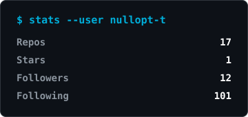
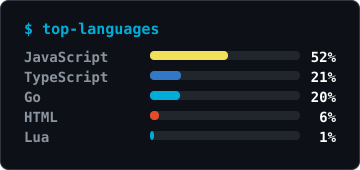

<p align="center">
  
</p>

```console
visitor@github:~$ ssh nullopt-t
Welcome 👋 I'm Amr Ali, a backend engineer who loves building
things and figuring out how they work.
```

<!-- <p>
  
</p>

<p>
  
  
  
  
</p> -->

<p align="center">
  <a href="https://github.com/nullopt-t"></a>
  <a href="https://www.linkedin.com/in/nullopt-t"></a>
  <a href="mailto:amrmohamed00975@gmail.com"></a>
</p>

<p align="center">
  
  
</p>
